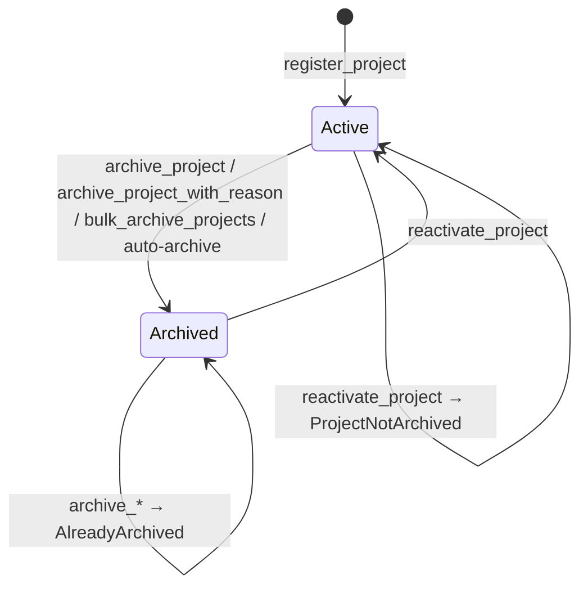

# Project Lifecycle — Archive State Machine (#873)

A project is either **Active** (`archived == false`) or **Archived**
(`archived == true`). Registration always starts in **Active**.

## Transitions

| Entry point                                         | From → To         | Who                 | Records reason |
|-----------------------------------------------------|-------------------|---------------------|----------------|
| `archive_project(project_id, caller)`               | Active → Archived | owner or admin      | no             |
| `archive_project_with_reason(project_id, caller, reason)` | Active → Archived | owner or admin | yes            |
| `bulk_archive_projects(caller, project_ids, reason)` | Active → Archived (each) | owner or admin of every project | yes |
| auto-archive keeper (#753)                          | Active → Archived | authenticated keeper | no            |
| `reactivate_project(project_id, caller)`            | Archived → Active | owner or admin      | clears reason  |

`ArchiveReason` is one of `Maintenance`, `Migration`, `Discontinuation`.
The current reason is readable via `get_archive_reason(project_id)` and is
removed when the project is reactivated.

## Bulk archive

`bulk_archive_projects` takes 1–100 (`MAX_PAGE_LIMIT`) project IDs; an empty
or oversized batch fails with `InvalidInput`. The batch is atomic: if any
project is missing (`ProjectNotFound`), not owned by the caller and the caller
is not an admin (`Unauthorized`), or already archived (`AlreadyArchived`), the
whole call reverts. Returns the number of projects archived.

## Audit log

Every owner/admin archive and every reactivation appends an
`ArchiveAuditEntry { project_id, action, caller, reason, timestamp }` under
`ArchiveLifecycleKey::AuditEntry(project_id, index)`. The log is append-only and
read with `get_archive_audit_log(project_id, start, limit)` (oldest first,
`limit` capped at 100).

## Effects of being archived

- Excluded from `list_projects`, owner active-project indexes, and tag/category
  listings.
- Cannot be updated, reviewed, or submitted for verification until reactivated.
- `ProjectArchived` / `ProjectReactivated` events and notifications are emitted.
